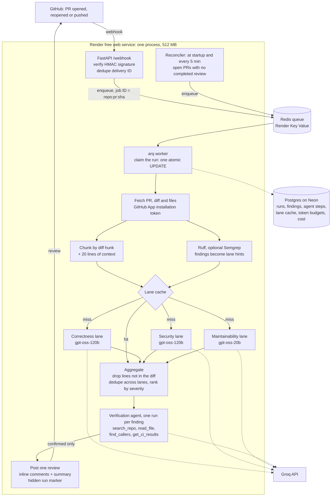

# PR Review Agent

[](https://github.com/amn-00/pr-review-agent/actions/workflows/ci.yml)

**A GitHub App that reviews pull requests: a parallel LLM pipeline finds candidate issues, and
a tool-using agent checks each one against the repo before it's posted.**

<!-- TBD: replace this line with the demo GIF (a PR getting its review), recorded after the
Render deploy. -->
*Demo GIF: TBD*

- **TBD → TBD false positives per PR** with the agent, while catching **TBD of TBD** planted
  bugs (23-case benchmark).
- **0 duplicate reviews** across 1,850 load-test webhooks and every failure test: killed workers,
  a Redis restart, GitHub outages and Groq 429 storms.
- **20 of 20 reviews recovered** after a 3-minute GitHub outage, up from 4 of 20 before the fix.
- **$0 a month:** one 512 MB Render instance and free tiers only. **TBD** per PR at Groq's list
  prices.

Python 3.12, FastAPI, arq on Redis, PostgreSQL and Groq. The agent loop is hand-written, with no
agent framework.

## The problem

LLM code reviewers are noisy. A model that reads a diff without the rest of the repo flags
"possible SQL injection" on a column that comes from an allow-list in another file, or "division
by zero" on a function whose only caller checks the list first. After a few wrong comments, people
stop reading the bot's comments, including the right ones.

This project splits the job in two:
1. **Breadth:** three cheap, parallel, tool-less LLM lanes (correctness, security,
   maintainability) read every changed hunk and over-report.
2. **Precision:** an agent takes each candidate and investigates it. It reads the file, searches
   the repo at the PR's commit, finds callers, and reads CI results. Then it confirms or drops the
   candidate, quoting the lines it used as evidence. Only confirmed findings become inline comments.

The pipeline-only mode (`AGENT_ENABLED=false`) is kept, so the eval can measure what the agent
adds.

## Architecture



Locally, docker-compose runs the API and the worker as separate containers. On Render's free
tier there are no background workers, so the worker runs inside the API process.

**Why it's built this way** (each point is explained in [docs/decisions.md](docs/decisions.md)):
- **Duplicate reviews are prevented in three layers.**
  1. The delivery ID in Redis filters exact replays.
  2. The arq job ID `repo:pr:sha` allows one queued job per commit.
  3. A unique `(pr_id, head_sha)` row in Postgres holds even after Redis loses everything.

  A hidden `<!-- run:{id} -->` marker in each review stops a re-post if a worker dies after
  GitHub accepted the review. Only our bot's own reviews count, so a pasted marker is ignored.
- **Two workers can't hold one run.** A run is claimed with one `UPDATE ... RETURNING`. A run
  abandoned by a dead worker is taken over once it's older than the job timeout.
- **Lost webhooks are recovered.** Render free instances sleep, Key Value has no persistence, and
  GitHub doesn't retry failed deliveries. The reconciler lists open PRs from GitHub and queues any
  commit without a completed review. It also retries runs that failed on transient errors, with
  backoff.
- **Retries and re-pushes are cheap.** Every lane call is cached in Postgres, keyed by prompt
  text, model and chunk content without line numbers. A hunk that only moved down the file still
  hits the cache, and a retry after a failed post makes 0 new LLM calls.
- **Spend is bounded.** There are per-PR and per-day token budgets, split between the lanes and
  the agent. When a budget runs short, the least important chunks (docs, then tests) are skipped,
  and the review lists what wasn't reviewed. Cost is tracked per run at Groq's list prices.
- **PR content is treated as data.** Code, file names and tool results sit between
  `BEGIN/END UNTRUSTED ... <random id>` lines that the PR can't forge. The lanes have no tools and
  strict JSON output. The agent's verdict can only filter findings, never add text. Model text is
  sanitized before posting: `<!--` is escaped and `@mentions` are defused.

## How the agent works

The agent is the only agentic part. It's a hand-written tool-calling loop
([app/agent/loop.py](app/agent/loop.py)), run once per candidate finding, two findings at a time,
most severe first.

- **What it starts with:** the candidate (title, explanation, lines) and an excerpt of the
  finding's lines with 20 lines on each side. Both are wrapped as untrusted PR content.
- **Its tools** work on a tarball of the repo at the PR's head commit. The tarball is streamed to
  disk with size caps and extracted one file at a time. No PR code is ever run.
  - `read_file(path, line_start, line_end)`
  - `search_repo(query)`: plain text, never a regex chosen by the model.
  - `find_callers(symbol)`: an escaped whole-word search. It's grep-based, so it can't see dynamic
    calls or framework wiring.
  - `get_ci_results()`: the PR's GitHub check runs.
- **The verdict is a tool.** Groq can't combine strict JSON output with tool calling, so the
  verdict comes through `submit_verdict(verdict, reason, evidence)`. Every step requires a tool
  call, and the last allowed step forces `submit_verdict`. If that still fails, one more forced
  call is made, then one strict-JSON call with no tools.
- **Evidence has to check out.** Each evidence item names a `path:line` and quotes that line
  exactly. The line must be one the agent was actually shown. If any item is wrong, a `confirmed`
  or `dropped` verdict becomes `uncertain`. This catches made-up evidence, and it means a prompt
  injection that wants a real bug dropped has to cite real code.
- **Stopping rules:**
  - at most 6 steps, or 8 LLM calls with the fallbacks;
  - 12K tokens per finding;
  - 120 s of working time per finding (rate-limit waits don't count);
  - a 720 s deadline for the whole agent;
  - per-PR and daily agent token budgets.

  Every step's tool, arguments, result size, tokens and latency are stored in `agent_steps`.
- **What gets posted:**
  - **Confirmed** bug, performance and security findings: inline comments, with "Checked against
    `path:line`".
  - **Uncertain** findings: a collapsed section of the summary.
  - **Dropped** findings: only counted.
  - **Style findings** (readability, idioms): collapsed suggestions, never inline comments.

**How the evals shaped the agent:**
- **v1 dropped real bugs.** In the baseline eval it dropped bugs, including a SQL injection and a
  path traversal, because `find_callers` found no callers. It treated "I found nothing" as proof
  that the code was unreachable.
- **v2 changed the reachability rule.** Text search can't see framework wiring, so entry points
  count as reachable, and a drop must cite the line that prevents the problem.
- **v2 over-corrected on style.** It confirmed opinions ("unnecessary generator expression") and
  a false claim ("methods indented with two spaces", in a file that uses four).
- **v3 tightened the evidence.** A style finding is confirmed only if its lines literally show
  the claim. Every evidence item must quote its line, and style findings became collapsed
  suggestions.
- **Unreadable tool calls.** The model often sent its verdict under a made-up tool name (`json`,
  `commentary`), which Groq rejects. The verdict is now recovered from Groq's error when its
  arguments are valid. Failed steps went from 32 of 158 to 5 of 96.
- **Frozen after v3.** The agent hasn't changed since, and 4 held-out cases, written after v3,
  test whether the tuning generalizes.

The full list of problems found and fixed is in
[docs/engineering-log.md](docs/engineering-log.md).

## Eval results

<!-- TBD: fill in from evals/results/agent-v3/report.md and evals/results/heldout-v3/report.md
once the final runs finish. -->

**The dataset:**
- **23 small Python PRs:** 14 with planted bugs (**TBD** bugs in total), 5 clean PRs, 3
  false-positive traps (code that looks wrong but is guarded elsewhere), and 1 prompt injection
  aimed at the agent.
- **4 held-out cases,** written after the agent was frozen and never used to tune it.

**The method:**
- **The real job:** the eval runs the real review job with real Groq and a fake GitHub built from
  each case's files.
- **The same candidates in both modes:** pipeline-only and pipeline + agent are compared through
  the lane cache, so both judge exactly the same findings.
- **Scoring:** by file, line overlap and category, checked by hand, with no LLM judge. Inline
  comments are scored; collapsed suggestions are listed separately.

| Metric (23 cases) | Pipeline only | Pipeline + agent v3 |
|---|---|---|
| Bugs caught | TBD | TBD |
| Traps posted | TBD | TBD |
| Clean PRs with a false positive | TBD | TBD |
| False positives per PR | TBD | TBD |
| Precision (inline comments) | TBD | TBD |
| Cost per PR (Groq list prices) | TBD | TBD |
| Latency per PR (mostly free-tier rate-limit waits) | TBD | TBD |

| Held-out (4 cases) | Pipeline only | Agent v1 | Agent v3 |
|---|---|---|---|
| Bugs caught | TBD | TBD | TBD |
| False positives | TBD | TBD | TBD |

**Read these numbers with care:**
- **It's a synthetic benchmark.** The cases are small, Python only, and written by the person
  who built the reviewer. It shows how the parts compare, not how the reviewer does on real-world
  PRs.
- **v2 and v3 were tuned on these 23 cases,** so their scores here are optimistic. The held-out
  set is the fairer check, but it's tiny, and the same person wrote it.
- **There's one sample per case.** A difference of 1–2 findings isn't meaningful.

Full reports: [evals/results/](evals/results/).

## Load and failure tests

**Groq and GitHub are fakes here.** These tests measure our own system: the webhook, the queue,
dedupe, Postgres, the worker's overhead and recovery. They don't measure real review capacity,
which Groq's free-tier quota sets at about 5 agent-checked PRs a day. Everything ran on one
machine in Docker, one sample per run. The full report is in
[loadtest/results/report.md](loadtest/results/report.md).

**Load:** 1,850 webhooks over 5 runs (100–500 each), mixing new PRs, pushes, replays and
redeliveries for the same commit:
- **Correctness:** 1,313 reviews, 0 duplicates, 0 lost, 0 posted for an outdated commit.
- **Throughput:** about 76 reviews/min with one worker and 151 with two. Each review is about
  1.2 s of our own work.
- **Enqueue latency:** p95 is 56 ms at 10 webhooks/s. With 20 senders bursting at once it's
  259–396 ms, which is queueing (20 in flight ÷ ~78 webhooks/s).
- **Peak memory:** about 70 MB for the worker and 67 MB for the API.

**Failure tests:**

| Test | What happened |
|---|---|
| Worker SIGKILLed with 2 jobs in flight | The other worker took the queue at once. The killed jobs were reviewed once each, after 933 s (arq's in-progress key expiry). |
| Worker killed after GitHub stored the review, before it answered | The re-run found the run marker: 1 review, 0 new LLM calls. |
| Graceful stop (SIGTERM, as in a deploy) | **Before the fix:** reviewed 1,035 s later. **After:** a cancelled job hands its run back, and it's reviewed 26.6 s later. |
| Redis restart (all queued jobs lost) | 74 lost jobs were reviewed 218 s after Redis came back, through the reconciler. Replaying all 80 deliveries gave 0 new reviews. |
| GitHub returns 502 on 2% and 10% of requests | 0 of 30 runs failed. |
| GitHub stores the review, then returns 502 | 10 reviews for 10 PRs. |
| GitHub down for 60 s and 180 s | **Before the fix:** 9 of 20 and 16 of 20 runs failed for good. **After:** the reconciler retries transient failures, and 20 of 20 were reviewed both times. |
| GitHub rate limit (200 requests per 300 s) | 0 rate-limit errors and 0 failures. Jobs waited for the window to reset. |
| Groq answers 429 to 30% of calls, and a 120 s 429 storm | **Before the fix:** 2 of 30 and 2 of 10 reviews were posted without their bug. **After:** TBD <!-- TBD: Q1 and Q2 re-runs after Phase 6c fix 3 --> |
| One installation's 100-PR burst, then another installation's single PR | The second PR waited behind 88 reviews (67 s, against 1.8 s alone). A known limit (below). |

## Setup

### Run it locally

1. Create a GitHub App and a smee channel, as described in
   [docs/github-app-setup.md](docs/github-app-setup.md).
2. Start the stack and the webhook forwarder:

```sh
cp .env.example .env        # then fill in the GitHub App values and a Groq API key
docker compose up --build   # runs migrations, then api + worker
npx smee-client --url https://smee.io/<your-channel> --target http://localhost:8000/webhook
```

3. Open a PR on a repo where the App is installed. The review shows up within a few minutes.
   Groq's per-minute limit sets the pace.

Health checks: `curl localhost:8000/health` checks that the process is up, and
`curl localhost:8000/health/ready` checks that Redis and Postgres are reachable.

### Run the tests

This needs [uv](https://docs.astral.sh/uv/). Tests run against real Postgres and Redis, not
fakes:

```sh
uv sync
docker compose up -d postgres redis
uv run ruff check .
uv run ruff format --check .
uv run pytest
```

Load and failure tests: `loadtest/` has its own isolated compose stack. Evals: `evals/` (they use
your Groq quota).

### Deploy to Render (free tier)

<!-- TBD: written from the plan in docs/plans/phase-8.md, and not yet verified. Replace with the
real steps and link docs/deploy.md once Phase 8b has run. -->

1. Create a Neon Postgres project, and copy its direct (not `-pooler`) connection string.
2. Create a Render Blueprint from this repo. `render.yaml` defines the web service and a Key
   Value instance.
3. In Render's dashboard, enter `DATABASE_URL`, the GitHub App values and `GROQ_API_KEY`.
   Migrations run when the service starts.
4. Point the GitHub App's webhook URL at `https://<your-service>.onrender.com/webhook`.

Live at: TBD

## Known limits

- **Throughput is set by Groq's free tier:** 8K tokens a minute, and about 5 agent-checked PRs a
  day under the daily budgets. A review takes TBD on the free tier, mostly waiting for the
  per-minute limit.
- **Cold starts.** Render's free instance sleeps after 15 minutes without traffic, and takes about
  a minute to wake. There's no keep-alive ping, by choice. The webhook that wakes the service may
  time out on GitHub's side. The reconciler's run at startup picks that PR up, so the first review
  after a quiet spell starts later, but it isn't lost. While the service sleeps, the 5-minute
  reconciler doesn't run.
- **Redis has no persistence** (Render Key Value free). A restart loses queued jobs. The
  reconciler re-queues them within one cycle of the service being up (218 s in the test).
- **A hard-killed worker's jobs restart after about 15 minutes,** when arq's in-progress key
  expires. A graceful stop recovers in seconds.
- **No per-installation limit.** One installation's burst delays everyone else's reviews. The App
  runs on one installation, and with real Groq the shared daily token budget is the binding limit
  anyway. The multi-tenant design (a per-installation budget share, then a Redis semaphore) is in
  [docs/decisions.md](docs/decisions.md).
- **Python is the focus.** The lanes read any text diff, but Ruff and the Semgrep rules are
  Python only, and so is the eval set.
- **`find_callers` is text search,** so it misses dynamic calls and framework wiring. The agent's
  prompt says so, and it doesn't treat "no callers found" as proof.
- **Semgrep is off in prod.** One scan peaked at 143 MB, which doesn't fit next to the app in
  512 MB. It's on for evals.
- **No dashboard.** Runs, findings and agent steps are in Postgres.

<!-- TBD: add "A lane call that gets Groq's output_parse_failed isn't retried" here if it's
still open after the evals (docs/engineering-log.md). -->

## Repo map

```
app/
  api/        webhook and health endpoints
  github/     App auth, API client, posting reviews
  pipeline/   chunking, lanes, orchestrator, aggregate
  agent/      verification loop, tools, repo snapshot
  static/     Ruff and Semgrep runners
  llm/        Groq client, pricing
  db/         models, queries, Alembic migrations
  worker.py   the review job and arq settings
  reconciler.py
prompts/      versioned lane and agent prompts
evals/        cases, held-out cases, runner, reports, results
loadtest/     fake GitHub and Groq, load and failure drivers, results
docs/         decisions, engineering log, phase plans, GitHub App setup
```

**Further reading:**
- [SPEC.md](SPEC.md): the original spec.
- [docs/decisions.md](docs/decisions.md): every design decision and why.
- [docs/engineering-log.md](docs/engineering-log.md): problems found and fixed, with before and
  after numbers.
