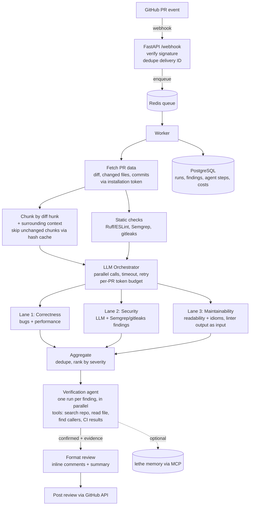

# PR Review Agent — Project Spec

## 1. What we're building
A GitHub App that reviews pull requests. When a PR is opened or updated, it:
1. Receives the webhook and queues a review job.
2. Runs a **parallel LLM pipeline** (3 lanes) over the diff to find candidate issues.
3. Runs a **tool-using verification agent** on each candidate to confirm or drop it with evidence.
4. Posts a single GitHub review with inline comments.

One-line pitch: **"A parallel LLM pipeline for breadth, plus a tool-using verification agent for precision."**

This is a portfolio project aimed at **AI agent + backend engineering** roles. The backend (queues, workers, idempotency, rate limits, failure handling) matters as much as the LLM part.

## 2. Rules for working with me (Claude Code, read this)
- **Plan before code.** At the start of each phase, give me a short plan (files, key decisions) and wait for my OK.
- **One phase at a time.** Stop at the end of each phase so I can review, run it, and commit.
- **Never run git commands that change history or the remote** (`git add`, `git commit`, `git push`, `git reset`, `git rebase`, etc.). I do all commits myself. Read-only git (`git status`, `git diff`, `git log`) is fine. At the end of each phase, suggest a commit message I can use.
- **I must be able to defend every line in an interview.** Keep code simple and readable. No clever abstractions. When you make a design decision, add 2–3 lines to `docs/decisions.md` explaining what and why.
- **Tests for every phase** (pytest). Failure paths get tests too, not just happy paths.
- **Ask before adding any dependency** not listed in section 4.
- **Do not use:** LangChain, LlamaIndex, CrewAI, AutoGen, or any agent framework. The agent loop is hand-written.
- **Do not use:** PyTorch, TensorFlow, MongoDB.
- **Free tier only.** Must run on Render free (512 MB RAM), Neon free Postgres, Upstash or Render Key Value free Redis, Groq free tier.
- Config and secrets via environment variables (`.env` locally, `.env.example` committed). Never commit secrets.
- Ruff + pytest in GitHub Actions CI from Phase 0.

## 3. Architecture



## 4. Stack
- Python 3.12, FastAPI, Uvicorn
- **arq** (async Redis job queue) for workers
- PostgreSQL (Neon) with SQLAlchemy 2.0 + Alembic migrations
- Redis (Upstash or Render Key Value)
- `httpx` for GitHub + Groq calls, `PyJWT` for GitHub App auth
- Groq for LLMs (model names in config, not hard-coded). Use JSON / structured output for lane results.
- Static tools: Ruff (Python), ESLint (JS/TS, optional), Semgrep, gitleaks. Each is optional and toggled by config, because 512 MB is tight.
- pytest, pytest-asyncio, respx (mock HTTP), Ruff
- Docker + docker-compose for local dev (api, worker, postgres, redis)
- Locust or k6 for load testing

## 5. Components (what each one must do)

### 5.1 Webhook endpoint
- Verify `X-Hub-Signature-256` with the webhook secret. Reject invalid requests with 401.
- Handle `pull_request` events: `opened`, `synchronize`, `reopened`. Ignore everything else with 200.
- **Idempotency:** store `X-GitHub-Delivery` ID in Redis (with a TTL). A duplicate delivery returns 200 and does not enqueue.
- Return fast (< 200 ms). All real work happens in the worker.

### 5.2 GitHub App auth
- Sign a JWT with the App's private key, exchange it for an **installation access token**, cache the token until shortly before expiry.
- Respect GitHub rate-limit headers. Back off when close to the limit.

### 5.3 Worker / job
- One job per (repo, PR, head SHA). If a newer commit arrives, cancel or skip the older job.
- Retries with exponential backoff for transient errors (5xx, timeouts, 429). Non-retryable errors are recorded and stop.
- If a worker dies mid-job, the job must be picked up again without posting a duplicate review.
- Per-installation concurrency limit. *(Deferred: see "The per-installation limit is not built" in `docs/decisions.md`.)*

### 5.4 Chunking
- Chunk by diff hunk, with N lines of surrounding context from the full file.
- Respect a max-tokens-per-chunk setting.
- Cache key = hash of (file path + chunk content + lane prompt version). Cached chunks are not re-sent to the LLM on a new push.

### 5.5 Lanes (plain LLM calls, NOT agents)
- 3 lanes, each with its own prompt in `prompts/` (versioned).
- Input: chunk + context + relevant static-tool findings.
- Output (validated with Pydantic): list of findings `{file, line_start, line_end, category, severity, title, explanation, suggested_fix?}`.
- Per-PR **token budget**. If the budget runs out, review highest-risk files first and note what was skipped.

### 5.6 Aggregate
- Dedupe findings that point to the same lines and same issue.
- Drop any finding whose file/line doesn't exist in the diff (hallucination guard).
- Rank by severity.

### 5.7 Verification agent (the only agent)
- Hand-written tool-calling loop using Groq tool calling.
- Tools:
  - `search_repo(query)` — code search in the repo at the PR head SHA
  - `read_file(path, start, end)`
  - `find_callers(symbol)` — where a changed function/class is used
  - `get_ci_results()` — read the PR's GitHub Actions check results (we do NOT run untrusted code ourselves on the free tier)
- Output: `confirmed | dropped | uncertain`, plus evidence (which files/lines it looked at and why).
- **Stopping rules:** max steps (e.g. 6), max tokens, timeout. Never loops forever.
- Every step (tool, args, result size, tokens, latency) is stored in the `agent_steps` table.
- Only `confirmed` findings are posted. `uncertain` ones go in a collapsed section of the summary comment.

### 5.8 Posting the review
- One GitHub review per run, with inline comments + a summary comment.
- Before posting, check that this run hasn't already posted (idempotent).
- Every comment's file + line must exist in the PR (final hallucination guard).

### 5.9 Optional: lethe memory (later phase, behind a flag)
- `MEMORY_ENABLED=false` by default.
- Before review: fetch repo memories (conventions, dismissed comment types, recurring bug areas) from lethe via MCP.
- After review, and when a maintainer resolves/dismisses a comment: write new memories.
- If lethe is down or asleep, the review still runs without memory.

## 6. Data model (PostgreSQL)
- `installations` — id, github_installation_id, account, created_at
- `repos` — id, installation_id, full_name
- `pull_requests` — id, repo_id, number, title, author
- `review_runs` — id, pr_id, head_sha, status, started_at, finished_at, tokens_in, tokens_out, cost_usd, error
- `findings` — id, run_id, lane, file, line_start, line_end, severity, title, explanation, verdict (confirmed/dropped/uncertain), posted
- `agent_steps` — id, finding_id, step_no, tool, args_json, result_summary, tokens, latency_ms
- `webhook_deliveries` — delivery_id, event, received_at (or Redis only, decide in Phase 1 and note why)

Add indexes for the obvious lookups, and explain them in `docs/decisions.md`.

## 7. Suggested repo layout
```
app/
  api/          # FastAPI routes (webhook, health, runs)
  github/       # app auth, API client, posting reviews
  pipeline/     # chunking, lanes, orchestrator, aggregate
  agent/        # verification loop + tools
  static/       # ruff/semgrep/gitleaks runners
  db/           # models, session, migrations
  worker.py     # arq worker settings + job functions
  config.py
prompts/        # versioned lane + agent prompts
evals/          # bug dataset, eval runner, results
loadtest/
tests/
docs/decisions.md
docker-compose.yml
```

## 8. Build phases (stop after each one)

**Phase 0 — Scaffold.** Repo layout, config, docker-compose (api, worker, postgres, redis), health endpoint, Ruff + pytest + GitHub Actions CI, `.env.example`.
*Done when:* `docker compose up` works, CI is green.

**Phase 1 — Webhook → queue → worker.** Signature check, delivery-ID dedupe, enqueue, GitHub App auth, worker posts a placeholder comment ("review started") on the PR. DB tables for installations/repos/PRs/runs.
*Done when:* opening a PR on a test repo gets a comment; a replayed webhook does NOT create a second job (tested).

**Phase 2 — Pipeline.** Fetch diff, chunk, 3 lanes in parallel with timeout/retry, aggregate, post a real review with inline comments.
*Done when:* a test PR with a planted bug gets a correct inline comment.

**Phase 3 — Static tools + caching + budget.** Linter/Semgrep/gitleaks inputs, hash cache, per-PR token budget, cost tracking per run.
*Done when:* pushing a second commit only re-reviews changed chunks (tested); cost is stored per run.

**Phase 4 — Verification agent.** Tool loop, stopping rules, step logging, verdicts, only confirmed findings posted.
*Done when:* a planted false-positive gets dropped with evidence; the agent never exceeds max steps (tested).

**Phase 5 — Evals.** Dataset of ~30 PRs with known planted bugs + some clean PRs. Eval runner compares **pipeline only vs pipeline + agent**: bug catch rate, false-positive rate, cost per PR, latency per PR. Results saved to `evals/results/`.

**Phase 6 — Load + failure tests.** Load test with 100–500 simulated webhooks: throughput, p95 enqueue latency, p95 review time, duplicate reviews (must be 0). Failure tests: kill a worker mid-job, simulate Groq 429, simulate GitHub 5xx.

**Phase 7 — lethe memory (optional).** MCP client, memory on/off flag, eval comparing false-positive rate with vs without memory over a sequence of PRs.

**Phase 8 — Deploy + docs.** Deploy api + worker on Render free, README with architecture diagram, setup steps, eval results, and a short demo GIF.

## 9. Non-goals (don't build these)
- No web dashboard beyond a simple runs list (maybe later).
- No auto-fixing or pushing commits to PRs.
- No running untrusted PR code on our servers.
- No multi-agent setup.
